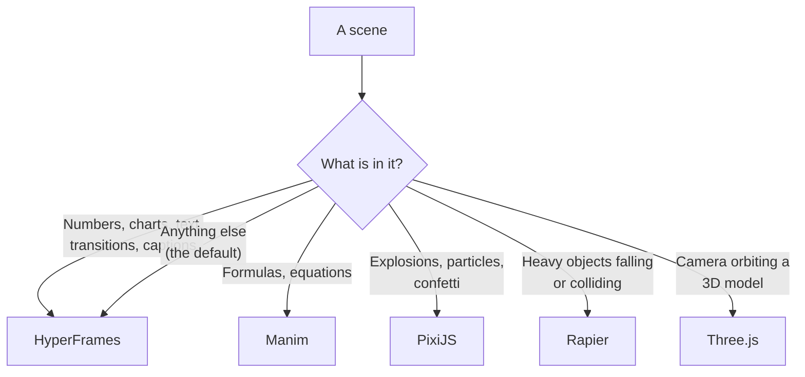

# Video Scene Tool Picker

> Pick the right code-based animation tool for each scene of your video, so you never reach for a heavy tool when a simple one works.


**Contents:** [Why](#why-this-exists) · [Decision tree](#decision-tree) · [Decision table](#decision-table) · [Examples](#examples) · [Rules](#rules) · [Why deterministic](#why-deterministic) · [Requirements](#requirements) · [Install](#install) · [Example prompts](#example-prompts) · [FAQ](#faq) · [Limitations](#limitations) · [License](#license)

## Why this exists

Code-driven video offers many tools, and choosing wrongly wastes hours: a physics engine for a simple fall, a 3D engine for a flat chart, a particle system where an overlay would do. This skill gives Claude one decision table and a few firm rules, so every scene gets the simplest tool that works.

## Decision tree



## Decision table

| What is in the scene | Tool | How |
|---|---|---|
| Numbers, counters, charts, text, transitions, overlays, captions | **HyperFrames** | Main editing tool: root composition, timeline, GSAP animation. Browse the catalog with `npx hyperframes catalog --tag=transition`, `--tag=overlay` or `--tag=text`. |
| Math formulas, equations, diagram drawing | **Manim** | Render a clip with `manim render -qh scene.py Scene` and place it in the HyperFrames composition as a muted `<video>`. Formula typesetting needs LaTeX. |
| Explosions, particles, sparks, smoke, confetti | **PixiJS** (v8) | 2D WebGL canvas, drawn from the time of each frame, with seeded randomness. |
| Heavy objects falling, collisions, piles | **Rapier** (2D/3D physics) | The simulation is pre-computed with a fixed step (for example 1/30 s) and read back by time. |
| Camera orbiting a machine or model (3D) | **Three.js** | 3D canvas driven by the frame time, with the composition's duration set. |

## Examples

| Scene | Tool | Why |
|---|---|---|
| A counter rising from 0 to 1 million with captions | HyperFrames | Numbers and text are its core job. |
| The quadratic formula appearing line by line | Manim | A formula on screen. |
| Confetti bursting at the end of a video | PixiJS | A custom particle effect (check the HyperFrames overlay catalog first). |
| Boxes dropping onto a table and tumbling | Rapier | Real collisions. |
| The camera circling an engine | Three.js | A 3D orbit. |
| A simple slide-in of a title | HyperFrames, with GSAP | No physics or 3D needed. |

## Rules

1. **Start with HyperFrames.** Most scenes (illustrations with narration, transitions and captions) need nothing else. The other tools are for graphics-heavy scenes only.
2. **Formula on screen?** Use Manim.
3. **Physics not needed?** Skip Rapier; simple motion is easier with GSAP.
4. **Simple 2D effect?** Check the HyperFrames overlay catalog first (film grain, light leak, glitch). Use PixiJS only for custom particles.
5. **No 3D needed?** Skip Three.js; it is heavy. Keep previews light on low-memory machines.
6. **Stay deterministic.** No `Date.now()`, no unseeded randomness, no network requests.
7. **Preview before rendering.** Rendering is expensive, so stay in preview and let the user decide when to render.

## Why deterministic

Every frame is drawn as a pure function of time (the `hf-seek` event's `e.detail.time` in HyperFrames). With no clock reads, no unseeded randomness and no network calls, any frame can be requested at any moment and always looks the same.

## Requirements

| Needed | For |
|---|---|
| HyperFrames | The main composition (always) |
| Manim (Python) | Formula scenes |
| LaTeX | Formula typesetting (`MathTex`) in Manim; ask the user before using it if LaTeX is not installed |
| PixiJS, Rapier, Three.js | Particle, physics and 3D scenes |

Versions this skill was tested with (check the current releases before relying on them): Three.js 0.187, PixiJS 8.23, Rapier 0.21 (the `-compat` npm build), HyperFrames CLI 0.9, Manim 0.22. Install the libraries once in a shared tools folder and copy the library's built JavaScript file into each project's `lib/` folder, so projects load nothing from the network.

## Install

```bash
git clone https://github.com/jenny-gecglr/video-scene-tool-picker.git ~/.claude/skills/video-scene-tool-picker
```

Or download the folder and place it at `~/.claude/skills/video-scene-tool-picker`.

## Example prompts

- "How should we build this scene with an equation on screen?"
- "I want an explosion of confetti at the end. Which tool?"
- "This scene shows boxes falling onto a table. What do we use?"

## FAQ

**Why is HyperFrames the default?** Most scenes are illustrations with narration, transitions and captions, and it covers all of that on its own.

**Can I mix tools in one video?** Yes. The tool is chosen per scene; for example a Manim clip is placed inside the HyperFrames composition as a muted video.

**When should I avoid Rapier or Three.js?** When the scene needs no physics or no 3D. Simple motion is easier with GSAP, and Three.js is heavy.

## Limitations

- It is a decision guide: it picks the tool but does not build the scene for you.
- Formula scenes need a LaTeX install for formula typesetting.
- Versions listed above are the ones it was tested with and may need updating.

## License

MIT. See [LICENSE](LICENSE).
